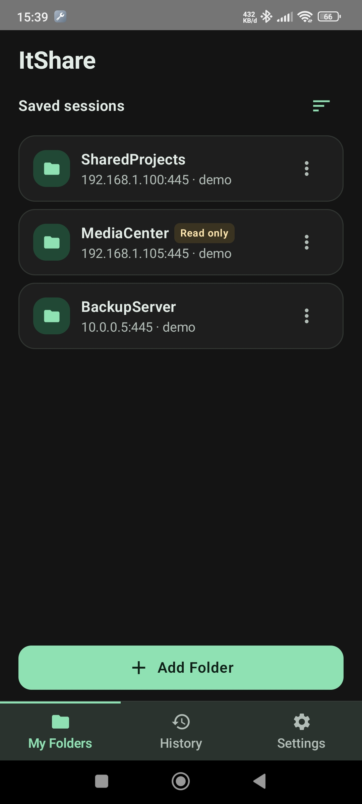
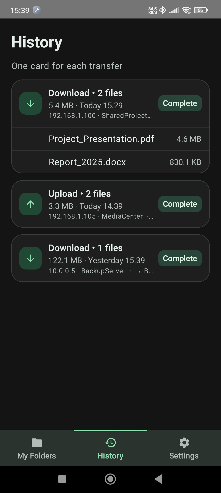
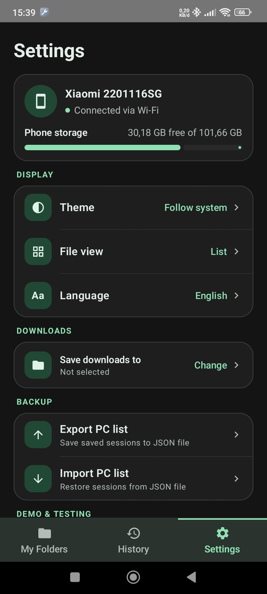
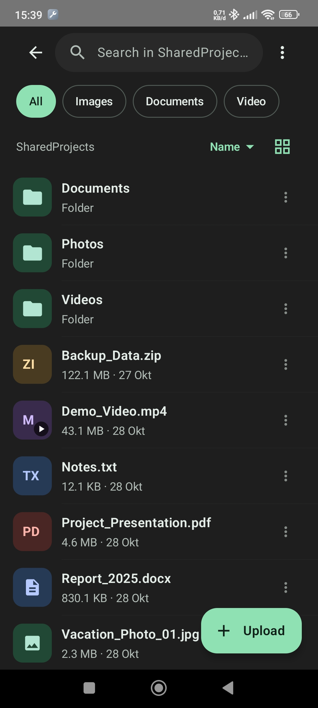
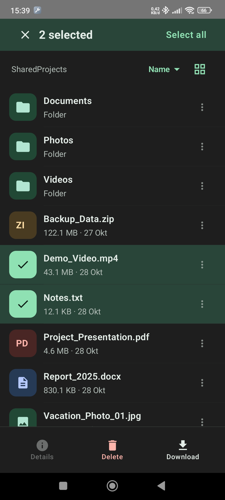
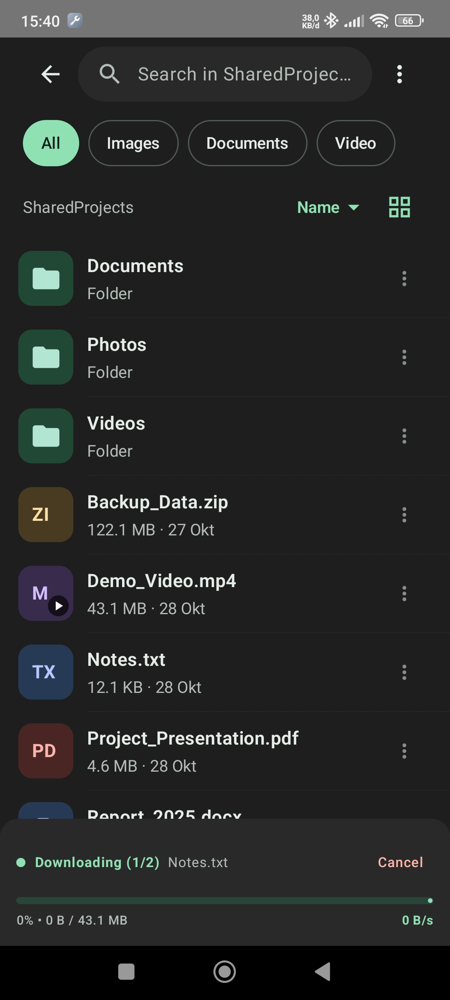

# ItShare Android

[-34A853?style=for-the-badge&logo=android&logoColor=white)](https://github.com/okkysatria/ItShare-Android/releases/download/v1.0.0/ItShare.apk)
[](https://github.com/okkysatria/ItShare-pc)

The Android client works with the [ItShare PC host](https://github.com/okkysatria/ItShare-pc). Start the host to share a folder and display its QR code, then scan it here or enter the SMB connection details manually.

## Screenshots

| Saved folders | Transfer history | Settings |
|---|---|---|
|  |  |  |

| File browser | File selection | Download progress |
|---|---|---|
|  |  |  |

## Features

- Connect to an ItShare PC share over SMB2/SMB3 using SMBJ.
- Scan an SMB or Wi-Fi QR code, or enter the SMB host, port, share, username, and password manually.
- Connect to a host Wi-Fi network from a Wi-Fi QR code when Android permits it. Android 10 and later may show a system confirmation prompt; WEP auto-connect is not supported on Android 10+.
- Save permanent SMB sessions securely on the device and reconnect later. Expiring QR sessions are not saved as permanent sessions.
- Browse folders, search the current folder, filter images/videos/documents, and sort by name, size, or date. Choose list or grid layout.
- Preview images and play videos from the SMB share.
- Download files and folders to a user-selected Android storage folder, and upload files selected through Android's document picker.
- Resolve transfer name conflicts by replacing, skipping, or renaming files. Read-only sessions prevent write and delete operations.
- Track transfer progress, speed, and recent transfer results. A foreground notification supports active transfers in the background and includes a cancel action.
- Use the interface in English or Indonesian, with system/light/dark theme options.
- Export and import a JSON backup of saved session details and app settings. Backups do **not** contain SMB passwords or transfer history; reconnect credentials must be provided again after import.

## Project layout

```text
.
├── app/
│   ├── build.gradle.kts
│   └── src/
│       ├── main/
│       │   ├── AndroidManifest.xml
│       │   ├── java/com/itshare/client/
│       │   │   ├── MainActivity.kt             # App state, screen routing, and UI-to-core actions
│       │   │   ├── ItShareApp.kt               # Android Application entry point
│       │   │   ├── core/
│       │   │   │   ├── backup/                 # JSON settings/session backup
│       │   │   │   ├── model/                  # SMB/Wi-Fi payloads and file/transfer models
│       │   │   │   ├── qr/                     # QR payload parsing and validation
│       │   │   │   ├── security/               # Encrypted saved SMB sessions
│       │   │   │   ├── service/                # Foreground transfer notification/service
│       │   │   │   ├── smb/                    # SMB connection, browsing, and file operations
│       │   │   │   ├── transfer/               # Upload/download, conflict handling, history
│       │   │   │   └── wifi/                   # Wi-Fi QR connection flow
│       │   │   └── ui/
│       │   │       ├── browser/                # File browser and image/video preview
│       │   │       ├── onboarding/             # Folders, transfer history, settings
│       │   │       ├── scanner/                # Camera QR scanner and manual SMB form
│       │   │       └── theme/                  # Compose theme and layout helpers
│       │   ├── res/                            # App strings and image assets
│       │   └── ...
│       └── test/                               # QR parser and backup unit tests
├── gradle/
│   └── libs.versions.toml                      # Dependency and plugin versions
├── build.gradle.kts
├── settings.gradle.kts
└── README.md
```

## Requirements

- Android Studio with Android SDK Platform 37 (the configured `compileSdk`).
- JDK 17.
- Android 8.0 (API 26) or later (`minSdk = 26`).
- A reachable ItShare PC host with an SMB share and valid credentials.

The current app configuration uses `targetSdk = 35`, `versionName = 1.0.0`, and `versionCode = 1`. Main dependencies include Jetpack Compose/Material 3, CameraX, Google ML Kit barcode scanning, SMBJ 0.15.0, Kotlin serialization, AndroidX Security Crypto, and coroutines. Dependency versions are maintained in `gradle/libs.versions.toml`.

## Permissions

The manifest declares the following permissions/features. Android prompts for permissions at runtime where required by the OS:

| Permission | Use |
|---|---|
| `INTERNET`, `ACCESS_NETWORK_STATE` | Connect to the SMB host and inspect network connectivity. |
| `ACCESS_WIFI_STATE`, `CHANGE_WIFI_STATE` | Wi-Fi connection support. |
| `ACCESS_COARSE_LOCATION`, `ACCESS_FINE_LOCATION`, `NEARBY_WIFI_DEVICES` | Wi-Fi connection flow on Android versions that require them. |
| `CAMERA` | Scan QR codes. Camera hardware is optional; manual connection is available without it. |
| `FOREGROUND_SERVICE`, `FOREGROUND_SERVICE_DATA_SYNC`, `WAKE_LOCK` | Keep a user-started transfer active while the app is in the background. |
| `POST_NOTIFICATIONS` | Transfer notification support on Android versions that require notification permission. |

The Android system controls some Wi-Fi connection behavior, including network selection prompts and permission requirements, and behavior can differ by OS version and device manufacturer.

## Build

On Windows, build a debug APK from the project root:

```powershell
.\gradlew.bat assembleDebug
```

On macOS/Linux:

```bash
./gradlew assembleDebug
```

The debug APK is generated at `app/build/outputs/apk/debug/app-debug.apk`.

## Unit tests

Run the local unit tests with:

```powershell
.\gradlew.bat testDebugUnitTest
```

Or on macOS/Linux:

```bash
./gradlew testDebugUnitTest
```

Current unit tests cover QR payload parsing and backup serialization/validation.

